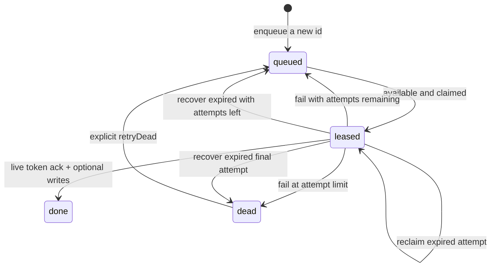

# Persistent local jobs

Use a queue for background reports, local import processing or deferred integration work owned by one application. Jobs survive database reopening; multiple worker threads sharing the same handle cannot claim the same live lease. This is a synchronous embedded queue, not a distributed broker or a background service.

```js
const queue = db.queue('reports');
queue.enqueue('report:request:123', { site: 'SDQ' }, { priority: 5, maxAttempts: 3 });
const job = queue.claim('worker-1', { leaseMs: 30000 });
if (job) {
  // Compute a result. External calls need their own stable idempotency key.
  const accepted = queue.ack(job.id, job.leaseToken, {
    operations: [
      { kind: 'put', collection: 'reports', key: job.id, value: { state: 'ready' } },
      { kind: 'put', collection: 'outbox', key: `ready:${job.id}`, value: { type: 'report.ready' } },
    ],
  });
  if (!accepted) console.log('Lease expired or another attempt owns this job.');
}
```

Python uses `db.queue(name)`, keyword arguments `priority`, `max_attempts`, `lease_ms` and job dictionaries with `lease_token`. Full executable examples are [Node](../bindings/node/examples/local-worker.mjs) and [Python](../bindings/python/examples/local_worker.py).

## Job lifecycle



- **Idempotent insertion:** an existing ID returns `{inserted: false, job: original}` and writes nothing, even if the supplied payload differs. Done/dead jobs retain their IDs. Inputs are still validated.
- **Scheduling:** `delayMs`/`delay_ms` controls availability. Claim chooses higher priority first, then earlier effective availability and lexical ID. Priority is 0–1000, max attempts 1–1000; defaults are 0 and 3.
- **Leases:** claim increments attempts and returns a token/expiry. `ack`, `fail` and `extend` require the current token and a non-expired lease. An old worker cannot acknowledge a reclaimed job.
- **Retries:** `fail` records an error and reschedules with `retryDelayMs`/`retry_delay_ms`, or marks the job dead at its attempt limit. Errors are 1–4096 UTF-8 bytes without NUL. Extending a lease never shortens it.
- **Recovery:** a claim can reclaim an expired attempt if retries remain. Call `recoverExpired`/`recover_expired` periodically and at startup to requeue expired jobs and mark exhausted leases dead. Default batch size is 10, allowed range 1–1000. On a frame-size error nothing changes; retry with a smaller batch.
- **Manual redrive:** `retryDead`/`retry_dead` resets attempts while keeping ID, payload, creation time, priority and max attempts. It does not delete the job or release its deduplication key.
- **Atomic results:** `ack` commits the completed job and optional business/outbox operations in a single frame. Invalid/oversized operations leave the lease and documents unchanged. An I/O failure has the normal uncertain-commit contract.

## Clocks, fencing and delivery

SDKs default to epoch milliseconds; `nowMs`/`now_ms` allows a caller-controlled clock and deterministic tests. Durations and timestamps must fit 0..2^53−1; lease durations are positive. Use a trusted, consistent application clock. Wall-clock changes can affect expiration; there is no clock synchronization service.

Tokens fence acknowledgements within one database history. They are not authentication credentials or globally unique distributed fencing tokens. A restored backup may fork a history and later reuse a previously seen future cursor/token: stop old workers and reconcile external effects when restoring. Do not run an original and its restored copy as interchangeable authorities.

The engine cannot undo a network call made by an expired worker. External effects may repeat after interruption and require destination-side deduplication. Job IDs and outbox events help build idempotent workflows; they do not promise exactly-once delivery.

## Data and capacity boundaries

Queue names contain 1–128 ASCII letters/digits/dots/underscores/dashes. IDs are nonempty UTF-8 strings up to 4096 bytes without NUL. Workers use 1–128 UTF-8 bytes without NUL; tokens must be nonempty and have no NUL.

Queue payload numbers in every runtime must be finite and within ±(2^53−1), so a Node worker can safely receive a Python/Rust job. Store larger identifiers as strings. Ordinary Python/Rust document collections retain their existing larger integer range.

Internal documents live in `_cedro.jobs.<name>`. Generic mutation APIs reserve that prefix; use queue methods to change jobs. Generic reads can inspect it for diagnostics. Queue scans validate the job schema, IDs, lease fields and numeric constraints rather than silently skipping malformed rows.

Claims and statistics scan the queue in O(n). Jobs, including completed/dead jobs, remain in live memory, and all transitions add to the log. There is no automatic pruning, retention, heap priority index, scheduler or multiprocess broker. Database statistics include the internal job documents.

Leave capacity for lease metadata, error text and future transitions within document/frame/state limits. A job that fits while queued can exceed a limit when claimed or retried: that transition fails atomically. Free capacity or reopen with appropriate higher limits before retrying; failures do not silently drop the job. Keep attachments and large results outside job payloads.

The application starts its own worker loop, handles shutdown and decides when to recover expired jobs. Keep disk operations off latency-sensitive main threads. See [the roadmap](roadmap.md) for the performance/failure evidence still required before 1.0.
